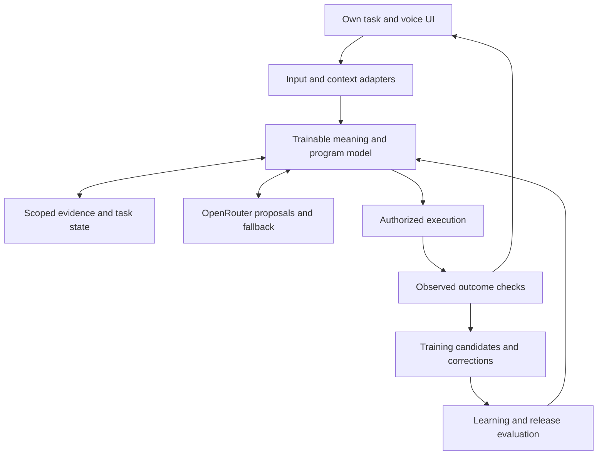

# Hikmah: a trainable architecture for sound, meaning, and action

## Architectural direction

Hikmah can begin as a co-model inside a capable agent product and gradually
become its principal trained model. The path is to learn specific capabilities,
measure them independently, and transfer responsibility from external models to
the owned system. The user interface, task workflow, memory, training records,
model versions, and execution controls belong to Hikmah from the beginning.

The proposed model combines a reviewed inventory of Quranic-root-linked senses,
learned compositional rules, reusable executable procedures, and predictions
about observable task outcomes. Speech provides an additional source of evidence
through its time-varying acoustic and phonetic structure. Text, visual inputs,
code, structured records, and tool observations remain valid inputs when sound
is absent.

This is a research architecture with a small executable learning result. It does
not establish a general model, human-level cognition, or AGI. The contribution to
develop is a particular representation, learning algorithm, and agent workflow
whose value survives comparisons with equally expressive alternatives. Existing
mathematics and research provide building blocks and baselines; an Arabic name
for an existing representation does not establish architectural novelty.

## A model that changes through learning

The central learned object is a versioned structured model:

\[
\mathcal M_t=(\mathcal O_t,\mathcal L_t,\Gamma_t,w_t,\mathcal H_t,T_t).
\]

The ontology \(\mathcal O\) holds reviewed senses and relation types. The lexicon
\(\mathcal L\) connects language-specific forms with candidate meanings.
Composition rules \(\Gamma\) and their learned scores \(w\) combine words or
other observations into propositions. The procedure library \(\mathcal H\)
contains bounded executable programs. The transition model \(T\) predicts
observable effects of actions in a stated environment.

Learning changes one or more of these objects from examples. It can add a useful
grammar rule, revise a lexical association, estimate an action's outcome
distribution, or acquire a reusable procedure. Merely saving another chat or
adding a retrieval record is a memory change; it does not demonstrate that the
model has learned a predictive mapping. An append-only record of outcomes and
an external authority policy support the model but are not freely rewritable
parts of its learning objective.

The model's reasoning operations are typed composition, matching, constrained
search, explicit uncertainty, and prediction checked against later observations.
It does not require transformer attention or learned dense semantic embeddings.
Numerical measurements, probabilities, and arrays remain useful mathematical
objects. Avoiding embeddings does not require avoiding numbers or statistical
learning. Processing language remains part of NLP as a field; the architectural
choice concerns the mechanisms used to do it.

## Frequency, sound, and meaning

Speech contains measurable structure, and research supports some systematic
relationships between sound and meaning. Blasi and colleagues found phonetic
associations in basic vocabulary across thousands of languages. These concern
statistical properties of speech sounds and lexical items, rather than a unique
acoustic frequency for each concept.[^1] Cross-language bouba/kiki experiments
also support sound–shape associations, within the limitations of their selected
stimuli and tasks.[^2]

There are several different quantities to model:

| Quantity | Representation | Possible role in Hikmah |
|---|---|---|
| Acoustic frequency | Time-local spectral components measured in Hz | Distinguish portions of speech and sound events |
| Pitch and formant trajectories | Estimates changing over time, with measurement uncertainty | Speech contrasts, pronunciation, and prosodic cues |
| Phonetic structure | Candidate phones, syllables, duration, and order | Learn form-to-meaning associations across examples |
| Occurrence frequency | Counts conditional on a corpus, language and context | Estimate rule probabilities and prioritize learning demand |
| Graph spectral frequency | Variation of a signal over a specified graph operator | Explore association structure and rank retrieval candidates |

The shared word “frequency” does not give these quantities a shared unit or an
automatic conversion. A relationship between them has to be specified and
evaluated. For example, high corpus frequency may justify caching a procedure,
but it does not make the procedure correct. A high graph eigenvalue is not a
high-pitched sound.

Acoustic interpretation needs context. Controlled vowel research documents the
value of duration and spectral change alongside static formants.[^3] Mandarin
tone research shows that neighboring tones affect pitch trajectories; blindly
normalizing away pitch can remove a linguistic contrast.[^4] A recording also
contains properties of the speaker, microphone, room and speaking style. These
must not be confused with the intended proposition.

Selected non-word vocalizations have conveyed intended meanings above chance
across languages, supporting an additional iconic channel.[^5] Such results do
not make arbitrary conversations understandable from raw frequency alone.
Signed and spoken vocabulary also show different patterns of iconicity, which
supports allowing multiple input modalities.[^6] The architecture therefore
tests sound as an informative channel alongside lexical, grammatical and
contextual evidence.

A useful research hypothesis is:

\[
I(M;A\mid P,L,C)>0
\]

for a declared task and population, where \(M\) is meaning, \(A\) acoustic
features, \(P\) candidate phonetic content, \(L\) language and \(C\) context.
This asks whether acoustics add information after accounting for those other
inputs. It is a proposed empirical test, not an established value for this
system. Test unknown-word acquisition separately, where phonetic structure can
help before lexical conventions have been learned.

## Mathematical structure without losing context

Represent a meaning as a typed event structure:

\[
G=(V,E,\tau,\Omega,\mathcal C,\mathcal P).
\]

Nodes \(V\) identify entities, events, concepts and values. Edges \(E\) represent
specific relations such as actor, recipient, cause hypothesis, evidence source,
or temporal order. The type system \(\tau\) distinguishes those relations.
Scoped operators \(\Omega\) preserve negation, conditions, quantities and
modality. Context \(\mathcal C\) supplies the relevant referents and task scope.
Provenance \(\mathcal P\) connects a candidate meaning to its original input,
annotation or observation.

A Quranic root indexes reviewed senses in this structure. A root can have
several contextual senses; several expressions can refer to one sense. A sound
similarity is a separate relation from root membership, semantic equivalence,
or causal association. New technical concepts, proper names, mathematical
objects and unresolved phrases use extension namespaces. They do not need a
forced root assignment.

For example, writing a document and prescribing an obligation remain different
events even where a source links their Arabic forms to the same root. Likewise,
“Sara helped Lina,” “Lina helped Sara,” and “Sara did not help Lina” must produce
different structures. The current learner tests a small single-event version of
these distinctions. Full quantification, discourse and conditional scope belong
to the broader specification and have not been implemented in that learner.

Graph mathematics can organize real relationships. For a separate undirected
association graph with nonnegative symmetric weights \(W\), define
\(L=D-W\), eigenvectors \(Lu_i=\lambda_i u_i\), and coefficients
\(\hat f_i=u_i^\top f\). These describe variation across that graph, as developed
in graph signal processing.[^7] Other graph operators produce different notions
of frequency.[^8]

The proposed use is to rank candidate neighborhoods for bounded recall or search.
It must not replace inspection of the actual directed semantic roles. A symmetric
association projection can lose the distinction between actor and recipient.
Smoothing a retrieval score must not smooth away a contradiction, negate a
permission boundary, or convert a hypothesis into an observed fact. Compare the
extra computation against exact identity and dependency retrieval before making
it part of the default core.

## The owned ecosystem

The diagram describes responsibilities rather than a requirement for nine
microservices. An initial TypeScript UI/API, one owned cognitive service, a
durable database, content storage and a job queue can implement the boundary.
Training and execution can use separate workers without duplicating the entire
runtime. The existing Hikmah architecture package specifies task versions,
permissions, operation receipts and recovery behavior.

There are two connected loops. The serving loop interprets the request, builds
a plan, obtains appropriate help, executes permitted actions and checks results.
The learning loop turns suitable observations and corrections into a candidate
model, evaluates it, and publishes a new version. The active version is pinned
for a task; background training does not silently replace its interpretation
rules midway through an external action.

OpenRouter initially provides broad language understanding, fluent responses,
code generation and research proposals. The owned model gradually replaces the
components that pass independent evaluation. External models can remain useful
for unfamiliar tasks or difficult generation. Their contribution is recorded
even when it is invisible in the ordinary user interface.

## Concrete learning mechanisms

### Language acquisition

Begin with aligned, reviewed examples and a bounded grammar. Learn associations
between language-specific forms and typed symbols, then learn reusable
composition rules. A rule can account for a new combination without storing a
complete answer for every possible sentence. Weighted grammar parsing provides
an established method for evaluating competing derivations.[^9]

For an annotated derivation \(d\), an initial rule update can use counts:

\[
c_{t+1}(r)=c_t(r)+n_r(d),\qquad
w(r\mid A)=\frac{c(r)+\alpha_r}
{\sum_{r':\operatorname{lhs}(r')=A}(c(r')+\alpha_{r'})}.
\]

The prior \(\alpha\), applicable language and grammar categories are explicit.
Uncertain examples should not be counted as certain derivations. More powerful
training can later marginalize over candidate analyses, but that introduces
additional assumptions and computational cost. The supplied local experiment
uses a simpler lexical-intersection and template-induction algorithm; it does
not implement this complete probabilistic grammar.

### Procedure acquisition

Define a small typed program language with pure transformations, comparisons,
bounded collections, conditionals and tool-call declarations. Search for
programs that solve verified examples while respecting types and resource limits.
A candidate objective is:

\[
J(p)=\lambda\operatorname{length}(p)+
\sum_i q_i\ell(p,e_i)+\mu\operatorname{executionCost}(p).
\]

The coefficients and loss are experimental choices. They are not inferred from
verse counts or acoustic frequencies. Counterexamples can eliminate or
specialize a candidate. Popper provides relevant research on learning programs
through failures; work on noisy logic-program learning changes the assumptions
needed when labels are imperfect.[^10][^11] Teacher-generated labels therefore
need a different status from independently checked counterexamples.

A discovered reusable procedure becomes part of a candidate library. Its benefit
must be demonstrated on new tasks and include search/training cost. The current
package learns linguistic templates, not general tool programs. Procedure
induction is the next larger experimental module.

### Action prediction and imagination

Learn a conditional transition model from actual before-state, action,
after-state and outcome records. Smoothed counts are a transparent starting
point in a finite state abstraction. Planning can explore predicted transitions,
but imagined outcomes remain separate from observations. Dyna provides an
established precedent for joining learning, planning and reacting.[^12]

An imagined scenario has explicit assumptions, an intervention, predicted
effects, and a model version. A subsequent observation can support or challenge
the prediction. An observational transition table does not automatically become
a general causal model. Hidden state, selection effects and changed tool
behavior require further evidence and a more suitable state representation.

Innovation can combine existing procedures or propose a new one, predict how
it would improve a task, and run a discriminating experiment. A new phrase, a
large number of suggestions or agreement among agents is insufficient evidence
of improvement. An experiment with a measurable consequence is the next step.

### Speech acquisition

Start with inspectable time-local acoustic features and pronunciation candidates.
An HMM/WFST adapter is a concrete non-transformer baseline with established
training machinery.[^13] It can supply a lattice of possible phone or word
sequences to the meaning learner. This is a baseline choice, not a claim that
its unrestricted multilingual quality matches current speech systems.

Alternative state-space, recurrent or oscillatory adapters can be evaluated
behind the same input contract. Add an alternative when a matched-data
experiment demonstrates useful quality, resource use or transfer. Introducing
several competing mechanisms at once would obscure which one helped. No speech
adapter was trained for this package.

## From co-model to main model

| Stage | Responsibility gained | Evidence needed |
|---|---|---|
| Observer | Predict beside the existing system | Reliable labels, meaningful errors, known coverage |
| Language specialist | Interpret selected constructions and meanings | Unseen compositions, role/polarity accuracy, ambiguity handling |
| Task specialist | Plan and complete bounded task families | Verified results, recovery, retained constraints, cost |
| Task leader | Coordinate several accepted capabilities | Novel combinations, interruptions, unfamiliar conditions |
| Primary owned system | Complete a declared workload without external model assistance | End-to-end results with external solving components disabled |

Progress is tracked by task, language, modality and environment. An owned parser
does not imply an owned fluent generator. An owned planner fed by a third-party
speech recognizer is not yet an end-to-end owned voice model. Conversely, an
owned model running on rented remote infrastructure remains an owned model.
Define ownership by the evaluated model boundary and its dependencies, not by
whether the hardware is local.

The release gate uses measured error, coverage, retained capabilities and full
workflow cost. It does not use a model's self-reported intelligence. The system
can collect and evaluate candidates automatically under a preapproved release
policy; learned components cannot rewrite that policy or expand access. Greater
capability changes which tasks the model can lead, while permissions remain tied
to the actual user mandate.

Training capacity grows in response to evidence: a larger vocabulary, richer
grammar, useful program abstractions or an improved sequence model. Memory size,
parameter count, graph size and permission scope are different quantities.
Adding compute does not guarantee that any of them produces useful intelligence.

## Training from teachers and real outcomes

External models provide a starting curriculum. Distillation research establishes
that one model's predictive behavior can help train another.[^14] Cross-architecture
transfer also has empirical precedents, but access conditions matter: Llamba's
method uses teacher internals and transferred weights that ordinary API text
access does not provide.[^15] Hikmah's initial pipeline therefore learns from
permitted visible targets and independently checked outcomes, without assuming
access to a teacher's hidden activations or private reasoning.

The useful training unit is a task episode: original input, context, candidate
meaning, proposed plan, observed before/after state, acceptance evidence, and
correction. Each field has its own verification status. A passing code test can
verify one property of an artifact while the interpretation of the original
request remains uncertain. Model agreement is not a substitute for that check.

Train on learner failure states as well as polished teacher demonstrations.
Imitation-learning research shows why a student's own actions can lead into
states missing from the demonstration distribution.[^16] In Hikmah, collect those
states in sandboxes or shadow operation and obtain reliable corrections. The
correction can come from a user, reviewer, exact tool or external model proposal,
with the source and validation status retained.

OpenRouter documents a distillable-text filter for eligible model authors.
Apply it to training collection routes and keep constraints through fallback.
It does not establish rights to the input corpus or authorize private customer
data reuse.[^17] Keep operational memory, tenant-specific adaptation and shared
training permissions separate. No paid model requests or external training data
collection were performed for the local experiments here.

Preserve diverse original/reference data and difficult exceptions. Recursive
training on generated data can cause degeneration in studied settings; other
research finds that retaining and accumulating original data can avoid that
outcome in its experiments.[^18][^19] These results motivate recording provenance
and sampling decisions, rather than a universal rule that all synthetic training
is either safe or useless. Replay also has empirical support for reducing
forgetting in particular reinforcement-learning environments, while Hikmah must
measure its own retention.[^20]

The serving model changes only through a release process. Development data can
guide revisions, while a protected final set estimates performance after
selection. Once a release-test failure informs a revision, the next claim of an
untouched evaluation requires fresh protected data. A rollback restores the
previous active model for future work; it does not undo an external action that
already occurred.

## A useful user experience during apprenticeship

The first product should offer an owned task workspace with fluent interaction,
progress, artifacts, memory controls and recovery. External models can provide
the language fluency while the co-model learns underneath. This supports a
capable agent experience from an early release without representing every
capability as already owned.

| User need | Product behavior | What the owned runtime maintains |
|---|---|---|
| Explain a goal naturally | Accept text or voice, preserve language and context | Original request, interpretation alternatives and task version |
| Work across several steps | Show concise progress and deliver actual artifacts | Dependencies, bounded parallel work, receipts and checkpoints |
| Interrupt or correct | Update the current goal and stop invalidated future steps | New contract version and reconciliation of ongoing actions |
| Remember useful context | Recall applicable preferences and commitments | Scoped records, freshness, correction and retention controls |
| Research or imagine | Show hypotheses, evidence and experiments distinctly | Scenario state, source lineage and observed outcomes |
| Improve over time | Explain relevant learned preferences or procedures when useful | Candidate updates, evaluations and active versions |

The normal interface does not require inspecting roots or a graph. An advanced
Meaning view can show the original expression, inferred roles, sound alignment,
candidate sense and unresolved fields. A Model view can expose the workload the
owned system currently handles, evaluation history and external dependencies.
These views support review without crowding everyday task flows.

Human-like collaboration is an operational target: continuity, relevant
questions, initiative within authority, useful explanations, successful repair,
and appropriate responses to changing context. Do not fabricate emotions,
consciousness, internal thought transcripts or completion status to make the
interface appear more human. Measure behavior and task outcomes. State-based
agent benchmarks provide useful precedents for evaluating consequences and
repeatability rather than eloquent answers alone.[^21]

## Local experiment: genuine but bounded acquisition

The earlier architecture prototype received manually assigned semantic frames
and verified 25 runtime mechanics tests. The new experiment adds an actual
supervised learning step. Its training algorithm induces token-to-symbol
associations and surface templates from labeled controlled utterances. The
schema, tokenizer and induction algorithm are supplied; the language-specific
surface generators are used to author the dataset and are not passed into
training.

The corpus uses AI-authored English, Arabic and Hindi sentences. It has not been
validated by linguists. Seed 72301 fixes the split before fitting: 48 semantic
families for training, 12 for development and 12 for final evaluation. Translations
remain together. A separate challenge set probes unsupported wording and scope.
All three languages receive supervision; this is not zero-shot language transfer.

| Model version | Training utterances | Learned surface rules | Exact frames out of 51 representable cases | Frames emitted out of 53 requests |
|---|---:|---:|---:|---:|
| Empty model | 0 | 0 | 0 | 0 |
| Initial learned model | 144 | 8 | 36 | 36 |
| Accepted learned update | 150 | 9 | 41 | 41 |

The six additional training examples teach an emphatic English construction.
Selection uses development cases. The chosen version then obtains 41/51 exact
frames, or 80.4%, counting abstentions on representable cases as failures. It
answers 41/53 requests, or 77.4% coverage. All 41 emitted frames match their
synthetic labels; 12 requests receive abstentions. Two requests exceed the
single-event schema and are reported separately rather than given invented gold
frames.

These figures are results on a tiny, constructed task, not a general accuracy
estimate. The 36 core translation rows represent 12 signed families and 11
distinct actor–action–patient triples. Seven of those triples appeared in
training with opposite polarity; four triples were wholly unseen. The exact
training-to-test generalization claim must retain that distinction. The empty
model comparison shows that acquisition occurred, but is not a competitive
benchmark against another learning architecture.

A deliberately corrupted future-tense update produces seven wrong development
predictions and is rejected. The experiment does not learn an automatic repair
for that corruption. Unknown vocabulary, new spellings, untrained tense,
questions and more complicated scope still expose the learner's limits. No
model/data changes were made in response to final-test errors.

Replacing action/root-sense symbols with a consistent arbitrary bijection leaves
all 53 predictions unchanged after inverse mapping. This is the expected control
for symbol identity. It does not demonstrate an advantage from Quranic roots.
That advantage would require comparing useful root-informed groupings against
equally expressive neutral groupings under matched training budgets.

Thirteen integrity and mechanics tests accompany the learner, including split
boundaries, actual learned structure, selection behavior and relabeling. The
experiment has no speech data, external model calls, transformer, learned dense
embedding or general-purpose reasoning engine. The code, frozen corpus,
selection receipt, learned model and every final prediction are included.

## Local experiment: frequency and temporal order

A second control tests what a magnitude-only frequency representation discards.
It generates a 440 Hz tone followed by an 880 Hz tone and then reverses the full
sampled signal. For a real finite signal, time reversal preserves the discrete
Fourier magnitude:

\[
\left|\operatorname{DFT}(x[N-1-n])\right|
=\left|\operatorname{DFT}(x[n])\right|.
\]

The numerical relative magnitude difference is approximately
\(2.84\times10^{-16}\). Time-local spectra and block-ordered features retain
the opposite sequence of tones. This supports preserving time and structure
instead of expecting one magnitude summary to identify an ordered event.

This is a synthetic signal control, not a speech or meaning-recognition
experiment. A complete complex Fourier transform retains phase and is
invertible; the test does not claim that Fourier analysis inherently loses the
signal. Nor does mathematical recovery of a waveform supply its meaning without
a learned and contextual interpretation. The figure and supporting CSV values
are included in `experiments/acoustics/`.

## Research program and acceptance evidence

The next substantial dataset should contain independently reviewed utterances,
contextual meanings and authorized task outcomes. Add consented recordings after
the text-to-meaning interface is stable. Hold out speakers, recording sessions,
scenario families and relevant language families according to the claim being
tested. Test whether audio adds value beyond the same text/context baseline.

Compare the complete design with a frozen rule system, episode retrieval,
grammar learning alone, an equally expressive neutral ontology, and a capable
external-model baseline behind the same workflow. Then remove the root grouping,
acoustic cues, learned procedures and graph retrieval one at a time. Record
annotation effort, training compute and failed attempts, not just inference
speed. The experiment registry specifies twelve comparisons and their shortcut
controls.

For each evaluated component boundary, report unconditional success, attempted
coverage, accuracy among attempted outputs, unresolved cases and outside-schema
requests. End-to-end owned success excludes external-model or human task-solving
contributions within that boundary. Separately report final product success
after fallback. A product can be useful while its owned model still handles a
limited workload.

Cost accounting includes external calls, owned inference, retrieval, tools,
verification, failed attempts, training and data review. Stored graph nodes or
short Arabic identifiers are not billable-token measurements. Token use depends
on the external interface and tokenizer. A learned reusable procedure can reduce
repeated external work, but any net saving must be measured at the complete-task
level.

There is no established conversion from this learner's accuracy to an “AGI
percentage.” Broader competence requires unfamiliar-task performance,
compositional transfer, grounded acquisition, reliable long-horizon execution,
and retained abilities under change. These are measurable research directions,
not consequences that follow automatically from a root inventory or a sound
transform.

The next implementation milestone is a bounded owned task specialist integrated
with the existing UI/runtime design: learned semantic mapping, a small typed
procedure library, observed outcome checks and OpenRouter fallback. After that
slice succeeds on prospective evaluations, add another language, task family or
input modality without losing the previous capability. This creates a concrete
path from co-model to main model while preserving a useful product throughout.

## Sources

The companion source ledgers contain thirty primary research and official
documentation records with access scope and limitations. This is a targeted
research synthesis, not an exhaustive review of every proposed AI architecture.
The prior Quran review and root study retain their original interpretation and
annotation status in the included baseline package.

[^1]: Blasi et al. (2016). [Sound–meaning association biases evidenced across thousands of languages](https://pmc.ncbi.nlm.nih.gov/articles/PMC5047153/).
[^2]: Ćwiek et al. (2021, issue 2022). [The bouba/kiki effect is robust across cultures and writing systems](https://pmc.ncbi.nlm.nih.gov/articles/PMC8591387/).
[^3]: Hillenbrand et al. (1995). [Acoustic characteristics of American English vowels](https://pubmed.ncbi.nlm.nih.gov/7759650/).
[^4]: Xu (1997). [Contextual tonal variations in Mandarin](https://www.homepages.ucl.ac.uk/~uclyyix/contextual_var.html).
[^5]: Ćwiek et al. (2021). [Novel vocalizations are understood across cultures](https://www.nature.com/articles/s41598-021-89445-4).
[^6]: Perlman et al. (2018). [Iconicity in Signed and Spoken Vocabulary](https://www.frontiersin.org/journals/psychology/articles/10.3389/fpsyg.2018.01433/full).
[^7]: Shuman et al. (2013). [The Emerging Field of Signal Processing on Graphs](https://arxiv.org/html/1211.0053v2).
[^8]: Sandryhaila and Moura (2013). [Discrete Signal Processing on Graphs: Frequency Analysis](https://arxiv.org/html/1307.0468v2).
[^9]: Opedal et al. (2023). [Efficient Semiring-Weighted Earley Parsing](https://aclanthology.org/2023.acl-long.204/).
[^10]: Cropper and Morel (2021). [Learning programs by learning from failures](https://arxiv.org/abs/2005.02259).
[^11]: Hocquette, Niskanen, Järvisalo and Cropper (2024). [Learning MDL Logic Programs from Noisy Data](https://ojs.aaai.org/index.php/AAAI/article/view/28925).
[^12]: Sutton (1991). [Dyna, an integrated architecture for learning, planning, and reacting](https://dl.acm.org/doi/10.1145/122344.122377). Original-paper access details are recorded in `research/core-sources.json`.
[^13]: Povey et al. (2011). [The Kaldi Speech Recognition Toolkit](https://www.danielpovey.com/files/2011_asru_kaldi.pdf).
[^14]: Hinton, Vinyals and Dean (2015). [Distilling the Knowledge in a Neural Network](https://arxiv.org/abs/1503.02531).
[^15]: Bick, Katsch, Sohoni, Desai and Gu (2025). [Llamba: Scaling Distilled Recurrent Models for Efficient Language Processing](https://arxiv.org/html/2502.14458v2).
[^16]: Ross, Gordon and Bagnell (2011). [A Reduction of Imitation Learning and Structured Prediction to No-Regret Online Learning](https://proceedings.mlr.press/v15/ross11a.html).
[^17]: OpenRouter. [Provider routing and distillable text enforcement](https://openrouter.ai/docs/guides/routing/provider-selection#distillable-text-enforcement), checked 9 September 2026.
[^18]: Shumailov et al. (2023 onward). [The Curse of Recursion: Training on Generated Data Makes Models Forget](https://arxiv.org/abs/2305.17493).
[^19]: Gerstgrasser et al. (2024). [Is Model Collapse Inevitable? Breaking the Curse of Recursion by Accumulating Real and Synthetic Data](https://arxiv.org/abs/2404.01413v2).
[^20]: Rolnick et al. (2019). [Experience Replay for Continual Learning](https://arxiv.org/abs/1811.11682v2).
[^21]: Yao et al. (2024). [τ-bench: A Benchmark for Tool-Agent-User Interaction in Real-World Domains](https://arxiv.org/abs/2406.12045).
